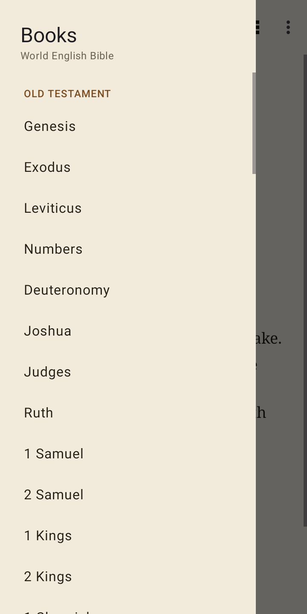
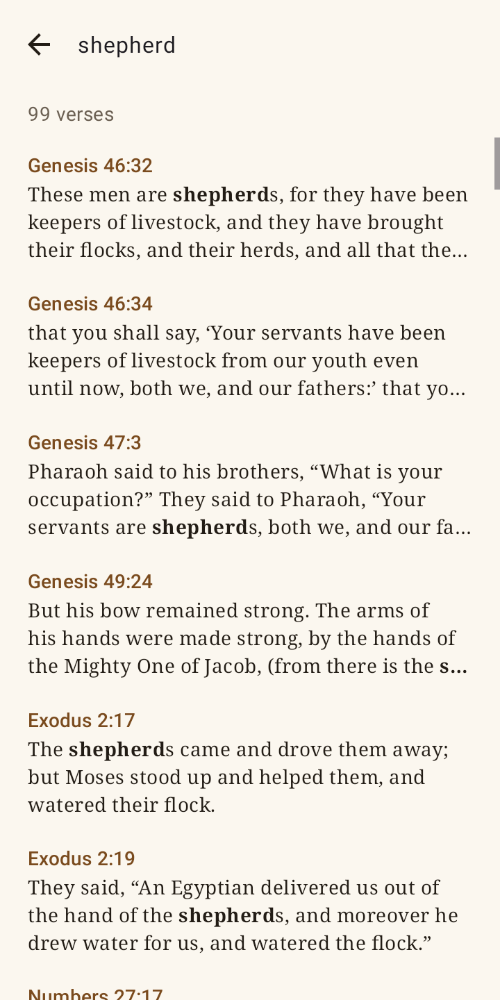

# Bible reader for Android

An offline Bible reader.

- Scroll vertically through the verses of a chapter.
- Swipe left and right between chapters, including across book boundaries.
- Open the side menu (top-left button) to jump to any of the 66 books, then pick a chapter.
- Tap the title or the grid button to pick another chapter in the current book.
- Search for words, or type a reference such as `John 3:16` or `ps 23` to go straight there.
  Put a phrase in double quotes to find those exact words.
- Long-press a verse to copy or share it.
- After a jump, Back returns to where you were reading.
- Change the text size from the overflow menu.

| Reading | Book menu | Search |
| --- | --- | --- |
|  |  |  |

The app follows the system light or dark theme, reopens where you stopped
reading, needs no permissions and works without a connection. It runs on
Android 6.0 and later.

A ready-to-install build is in `dist/Bible.apk` and attached to each release.

## Text

The bundled text is the World English Bible, which is in the public domain.
It is stored as plain text files in `app/src/main/assets/bible`, generated by
`tools/build_bible_data.py` from the `world-english-bible` npm package. The
script's header documents the file format; any translation you have the right
to use can be shipped by producing the same files.

## Building

Requires JDK 17 or newer and the Android SDK (platform 37).

    ./gradlew assembleRelease     # app/build/outputs/apk/release/app-release.apk
    ./gradlew testDebugUnitTest lintRelease

Without further setup the release build is signed with the Android debug key,
which is enough to install it directly. To sign with your own key, create
`keystore.properties` in the project root (it is ignored by git):

    storeFile=/path/to/your.jks
    storePassword=...
    keyAlias=...
    keyPassword=...

Android only installs an update over an app signed with the same key. Debug
keys differ from one machine to the next, so a build made elsewhere will not
install over `dist/Bible.apk` unless the app is uninstalled first or both are
signed with your own key.

## Releasing

Set `versionName` in `app/build.gradle`, copy the tested build to
`dist/Bible.apk`, commit, and push a matching tag such as `v1.0.0`. The
release workflow checks that the APK is that version and publishes a GitHub
release with it attached.
